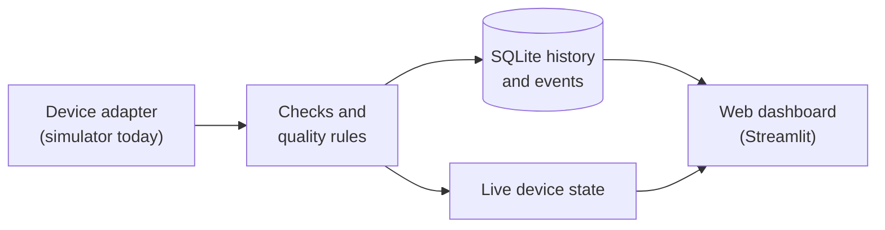

# Textile Industrial Automation

A local monitoring tool for textile machinery. It collects machine readings, checks them, and shows which data is current, old, or wrong.

> **Please read first.** The tool currently works with **simulated machines only**. All values it shows are synthetic and are labelled `SIMULATED`. It does not yet connect to real equipment. It is **read-only**: it cannot start, stop, or change any machine. It is not a safety system.

## Overview

Textile Industrial Automation reads measurements from machines, such as speed, temperature, or liquor level. It checks every reading before it is shown or saved. It keeps a history and records problems as events. A web dashboard on the same computer shows the current state of each machine.

The project is an early release (version 0.1.0). It is the software foundation for monitoring knitting, dyeing, and finishing machines. A real machine connection is the next step. See [Current Status](#current-status).

## Industrial Problem

Textile machines produce a lot of data. Examples are spindle speed, bath temperature, liquor level, pattern name, and running or stopped state. This data often stays on each machine's own display, controller, or sensor.

When it is collected in one place, three practical problems appear:

- **Old data looks current.** A screen can stop updating and still show the last number. Nobody notices that it is old.
- **A lost connection looks like a stopped machine.** If contact is lost, it is hard to tell whether the machine stopped or the monitoring failed.
- **Bad values are easy to miss.** A reading can be empty, out of range, in the wrong unit, or not a number.

This project does not try to control machines. It focuses on one question: **can we trust what the screen shows?**

## Proposed Solution

The tool treats three things separately, and never mixes them up.

| What | Question it answers | Possible values |
|---|---|---|
| Connection | Is the monitoring link to the machine working? | `DISABLED`, `DISCONNECTED`, `CONNECTING`, `CONNECTED`, `DEGRADED`, `RECOVERING`, `ERROR` |
| Data quality | Can this reading be trusted? | `VALID`, `STALE`, `INVALID`, `MISSING`, `UNKNOWN` |
| Machine state | What does the machine say it is doing? | `RUNNING`, `STOPPED`, `IDLE`, `FAULTED`, or "not reported" |

Some examples of how this helps:

- If a reading stops arriving, the last value stays on screen but is marked `STALE`. It is never replaced by zero or a guess.
- If the connection is lost, the machine state shows "Unknown". It does **not** show "stopped".
- A reading that fails a check is not saved as history. It is recorded as an event.
- `CONNECTED` means the link works and the latest reading passed every check. It does not mean the machine is running or safe.

## Key Capabilities

These features are implemented in this release.

- **Simulated machines.** A built-in simulator produces repeatable synthetic readings. The same settings always give the same values.
- **Simulated faults.** Faults can be scripted in the configuration file or started from the dashboard: read timeout, lost link, refused connection, missing measurement, invalid value, and slow response.
- **Reading checks.** Each reading is checked for type, valid number, configured range, unit, timestamp, missing values, duplicates, and unknown measurements.
- **Data quality labels.** A reading becomes `STALE` when it is older than three times the reading interval. This factor can be changed per device.
- **Safe failure handling.** After a failure the tool retries with growing delays. After a set number of failures the device goes to `ERROR`, and an operator can press Retry. One failing device does not stop the others.
- **History and events.** Accepted readings and events are stored in a local SQLite database. Repeated identical events are summarised so the log does not flood.
- **Restricted mode.** If saving fails, live values keep updating. The dashboard clearly states that history is not being saved.
- **Restart safety.** After a restart, values from the previous session are shown as `STALE` until they are read again.
- **Web dashboard.** Five pages: Overview, Devices, History, Diagnostics, and Configuration.
- **Configuration file.** Machines and measurements are described in a TOML file. The file is fully checked at start-up, and every problem is reported with its location.
- **Command-line tools.** Check a configuration, create the database, run without a browser, back up, and delete old history.
- **Local only.** The dashboard listens on `127.0.0.1` only. It sends no usage data. Secret-like settings (such as passwords or tokens) in a device's settings are rejected.

## How It Works

**Input → Process → Output**

| Step | What happens |
|---|---|
| Input | A device adapter reads the measurements of one machine. Today the adapter is the simulator. |
| Process | Each reading is checked. The connection state and data quality are updated. |
| Output | Valid readings are saved. Problems are recorded as events. The dashboard shows the current state. |

A typical use:

1. Describe each machine in `config\devices.toml`: name, measurements, units, and how often to read.
2. Start the application.
3. Open the dashboard in a browser.
4. Watch the connection state, data quality, and history of each machine.
5. Open Diagnostics to see rejected readings and events.

Example from the sample configuration. The simulated dyeing machine `sim-dye-02` has scripted faults. After about ten seconds its reads time out and its state changes to `DEGRADED`. The last values become `STALE`. The tool then reconnects, and the state returns to `CONNECTED`. Each step is recorded as an event.

## System Architecture

One Python program runs everything on one computer. There is no cloud service and no separate server.



| Part | Purpose |
|---|---|
| Device adapter | Talks to one kind of machine. It can only read. It has no write or command function. |
| Acquisition | Runs one worker per device. Enforces timeouts, retries, and a stop after repeated failure. |
| Checks and quality | Validates each reading and sets the data quality. |
| Storage | Saves accepted readings and events in SQLite. |
| Dashboard | Shows the state. It only reads state and never talks to machines. |

More detail is in [docs/ARCHITECTURE.md](docs/ARCHITECTURE.md).

## Technology Stack

| Technology | Use in this project |
|---|---|
| Python 3.12 or newer | Main language |
| Streamlit | Web dashboard |
| SQLite with SQLAlchemy 2 | Local database |
| Alembic | Database schema migrations |
| Pydantic 2 | Checks the structure of the configuration file |
| TOML (Python standard library) | Configuration format |
| Altair and pandas (installed with Streamlit) | Chart on the History page |
| pytest | Automated tests |
| Ruff and mypy | Code formatting, linting, and type checks |

## Installation & Setup

### Prerequisites

- Windows 10 or 11. The provided scripts are for Windows.
- Python 3.12 or newer from [python.org](https://www.python.org/downloads/). Install the `py` launcher option.
- Internet access for the one-time installation.
- Git, if you want to clone the repository.

### Install

Run these commands in Command Prompt or PowerShell.

```bat
git clone https://github.com/vipintk2807/textile-industrial-automation.git
cd textile-industrial-automation
scripts\setup.bat
```

`setup.bat` does three things:

- Creates a virtual environment in `.venv`.
- Installs the dependencies listed in `pyproject.toml`.
- Copies `config\devices.example.toml` to `config\devices.toml`. Edit this copy for your own devices. Git ignores it.

To install without the script:

```bat
py -3 -m venv .venv
.venv\Scripts\python.exe -m pip install -e ".[dev]"
copy config\devices.example.toml config\devices.toml
```

### Check the installation

```bat
scripts\test.bat
```

All tests should pass. The test run needs no hardware.

### Start

```bat
scripts\run.bat
```

Open <http://127.0.0.1:8501> in your browser if it does not open by itself. Press `Ctrl+C` in the window to stop.

To run without a browser for 30 seconds and print the device status in the window:

```bat
scripts\simulate.bat
```

## Usage

### Dashboard pages

| Page | Use it to |
|---|---|
| Overview | See device counts, a card per device, and the latest measurements. |
| Devices | See the device table and open a device for details. Press Retry on a device in `ERROR`. Start a synthetic fault on a simulated device. |
| History | Choose a device, a measurement, and a time range. See the chart and stored records. Download the range as CSV. |
| Diagnostics | See the persistence status, active faults, rejected readings, and the event history with filters. |
| Configuration | See whether the configuration is valid, the loaded devices, and where data is stored. |

The chart on the History page breaks the line where data is missing. It never joins points across a gap. The CSV file includes the data source of every row.

### Try a failure

1. Open **Devices** and select `sim-dye-02`.
2. Open **Simulator test controls**.
3. Choose **Read timeout** and press **Inject synthetic fault**.
4. Watch the connection state change, then recover. Open **Diagnostics** to see the events.

Fault injection works only on simulated devices. It is refused for any other adapter.

### Configure devices

Edit `config\devices.toml` and restart the application. A minimal valid file is `examples\simulator_config.toml`:

```toml
schema_version = 1

[[devices]]
device_id = "sim-01"
name = "Simulated device 01"
adapter_type = "simulator"

[[devices.measurements]]
key = "speed"
unit = "rpm"
[devices.measurements.source_mapping]
base = 100.0
amplitude = 5.0
```

Check a file without starting the monitoring:

```bat
.venv\Scripts\python.exe -m textile_automation validate-config --config config\devices.toml
```

Unknown settings are rejected, so spelling mistakes are not silently ignored. All problems are listed together with their location.

Optional environment variables:

| Variable | Meaning |
|---|---|
| `TEXTILE_AUTOMATION_CONFIG` | Path of the configuration file |
| `TEXTILE_AUTOMATION_DATA_DIR` | Folder for the database and logs |
| `TEXTILE_AUTOMATION_LOG_LEVEL` | `DEBUG`, `INFO`, `WARNING`, or `ERROR` |

### Data location, backup, and retention

By default, data is stored in `%LOCALAPPDATA%\TextileIndustrialAutomation\`. The database is `textile_automation.db`. Logs are in the `logs` folder.

```bat
.venv\Scripts\python.exe -m textile_automation backup D:\Backups\
.venv\Scripts\python.exe -m textile_automation purge --days 90
```

By default, nothing is deleted. To delete old history automatically, set `retention_days` in the `[storage]` section of the configuration file. More in [docs/OPERATIONS.md](docs/OPERATIONS.md).

### Other commands

```bat
.venv\Scripts\python.exe -m textile_automation init-db
.venv\Scripts\python.exe -m textile_automation run-simulator --seconds 30
```

## Project Structure

```text
app.py                  Dashboard entry point (Streamlit)
config/                 Example configuration (devices.example.toml)
examples/               Minimal configuration example
docs/                   Architecture, security, operations, verification notes
scripts/                Windows scripts: setup, run, test, simulate, quality, freeze
src/textile_automation/
  domain/               Core types: states, data quality, errors, models
  adapters/             Adapter contract, registry, simulator
  services/             Checks, state tracking, retries, events, acquisition
  storage/              SQLite models, migrations, repository, backup
  config/               Configuration loading and validation
  ui/                   Dashboard pages, theme, display helpers
  runtime.py            Starts and stops the whole application
  cli.py                Command-line tools
tests/
  unit/                 Fast tests of single parts
  integration/          Tests of connected parts, database, and dashboard load
  simulation/           Scenario tests using the sample configuration
```

## Current Status

This is an early release. It is a working, tested foundation, not a finished product.

| Area | State |
|---|---|
| Simulator, reading checks, connection states, data quality | Implemented |
| Database storage, events, retention, backup | Implemented |
| Dashboard with five pages | Implemented |
| Automated tests | 234 tests. All passed in the last full run on Windows. |
| Connection to real machines or sensors | Not implemented |
| Modbus TCP adapter | Not implemented. Deliberately deferred. See [docs/HARDWARE_INTEGRATION.md](docs/HARDWARE_INTEGRATION.md). |
| Sign-in, user accounts, remote access, alerts, machine control | Not implemented and not part of this release |

Not yet recorded in [docs/VERIFICATION.md](docs/VERIFICATION.md): a full manual check of every page in a browser, keyboard and screen-reader checks, and multi-day runs.

All behaviour so far is simulated. No claim is made about any real machine, protocol, or timing.

## Roadmap

These are intentions, not commitments.

- A read-only Modbus TCP adapter. It needs a documented register map for a real device and a test server, so we can prove it never sends a write command.
- Testing with real equipment, using the checklist in [docs/HARDWARE_INTEGRATION.md](docs/HARDWARE_INTEGRATION.md).
- Further protocols, such as OPC UA or MQTT, once a real use case exists.
- Access control, only if the dashboard is ever shared over a network. Today it listens on the local computer only.

## Contributing

1. Fork the repository and create a branch.
2. Run `scripts\setup.bat`.
3. Make your change and add or update tests.
4. Run `scripts\test.bat` and `scripts\quality.bat`.
5. Open a pull request and describe what changed and why.

Please follow these rules:

- Keep the tool read-only. A test scans the source for write and control operations and fails if it finds one.
- Label simulated data as simulated.
- Never commit passwords, tokens, or real factory network addresses.
- Do not present untested hardware behaviour as fact.

To add an adapter, read [docs/ARCHITECTURE.md](docs/ARCHITECTURE.md) and [docs/HARDWARE_INTEGRATION.md](docs/HARDWARE_INTEGRATION.md) first. Security notes are in [docs/SECURITY.md](docs/SECURITY.md).

## License

MIT. See [LICENSE](LICENSE). The software is not certified for safety-related use and must not be used to control or protect machinery.
